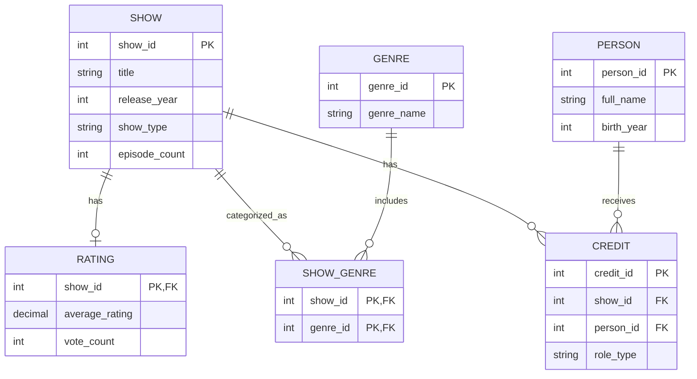

# TV Show Catalog - ERD

## Entity Relationship Diagram

## Relationships

1. SHOW to RATING: One show can have zero or one rating. Each rating belongs to exactly one show.
2. SHOW to SHOW_GENRE: One show can have zero or many genre associations. Each association belongs to one show.
3. GENRE to SHOW_GENRE: One genre can be associated with zero or many shows. Each association refers to one genre.
4. SHOW to CREDIT: One show can have zero or many credits. Each credit belongs to exactly one show.
5. PERSON to CREDIT: One person can have zero or many credits. Each credit belongs to exactly one person.

## Assumptions

1. Every show has a unique show_id.
2. Every person has a unique person_id.
3. A show may belong to multiple genres.
4. A show may have no rating yet.
5. A person can work on multiple shows.
6. A person can have multiple roles, such as Star and Writer, even on the same show.
7. The CREDIT table connects people and shows and identifies their roles.
8. The episode_count is stored at the show level. Individual episodes are not modeled because their details are not shown.
9. Birth year is recorded instead of the complete birth date.
10. Shows and people may exist in the database before their genre or credit associations have been entered.
11. A CREDIT record must represent a unique combination of show, person, and role, to prevent duplicate credits.
12. The number of other shows associated with a person can be calculated from CREDIT records rather than stored separately.
