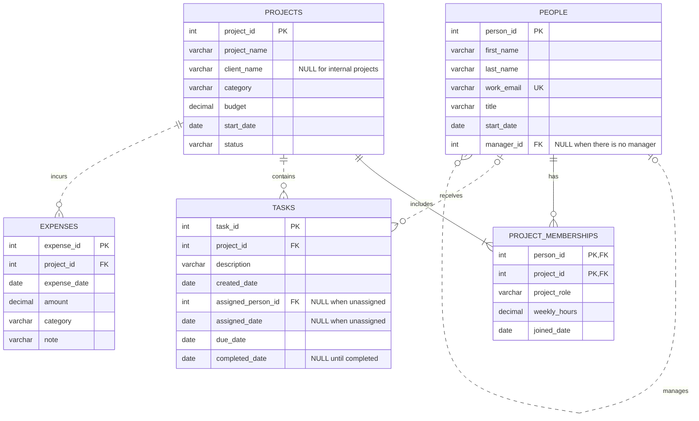

# 1. The Scenario

I chose Scenario A: BabsonAI Labs.

BabsonAI Labs is a startup founded by Babson students that builds
AI tools for small businesses. It has about 25 people and currently
tracks its work in spreadsheets and chat threads.

The database will organize information about employees, projects,
project memberships, tasks, and expenses. It will help the founders
understand who works on each project, how project spending compares
with budgets, and which employees are overloaded.

# 2. The ERD

# 3. What One Row Means

- **people:** One row represents one employee at BabsonAI Labs,
  including their details and the manager they report to, if any.

- **projects:** One row represents one project tracked by BabsonAI
  Labs, including its budget, start date, category, and status.

- **project_memberships:** One row represents one employee's
  membership in one project, including their role, weekly hours,
  and the date they joined that project.

- **tasks:** One row represents one task belonging to one project,
  including its dates and the employee assigned to it, if any.

- **expenses:** One row represents one expense incurred for one
  project, including its date, amount, category, and note.

# 4. Design Choices

### 1. Why I chose this primary key

I used `person_id` as the primary key instead of the employee’s email
address. The scenario says that email addresses can change when someone
changes their title. A person’s ID stays the same, so their tasks and
project memberships remain connected to the right person. Each email
address must still be unique.

### 2. Which information is optional

An employee can have no manager because the two founders do not report
to anyone. A project can have no client name because some projects are
internal. A task can have no assigned person when it is first created.
Its completion date also stays empty until the task is finished.

### 3. Which rules need separate checks

My current table constraints do not check whether a task’s assigned
person belongs to that project or whether the assignment happened
before the person started working at the company.

I will check these rules using SQL queries that compare tasks with
project memberships and employee start dates. Tasks 299 and 300
deliberately break the project-membership rule so I can check that
my query finds them.

### 4. One change I made to the AI-generated build

The AI-generated code created the same budget summary view twice.
I removed the duplicate block and kept one block using
`CREATE OR REPLACE VIEW`. This makes the build easier to follow
and avoids creating the same view twice.