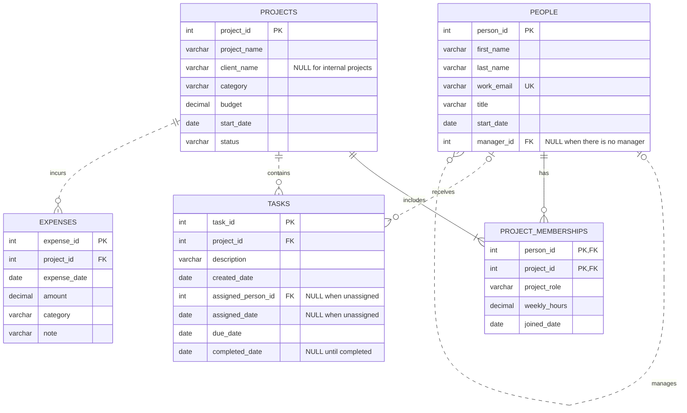

# 1. The Scenario

I chose Scenario A: BabsonAI Labs.

BabsonAI Labs is a startup founded by Babson students that builds
AI tools for small businesses. It has about 25 people and currently
tracks its work in spreadsheets and chat threads.

The database will organize information about employees, projects,
project memberships, tasks, and expenses. It will help the founders
understand who works on each project, how project spending compares
with budgets, and which employees are overloaded.

# 2. The ERD

# 3. What One Row Means

- **people:** One row represents one employee at BabsonAI Labs,
  including their details and the manager they report to, if any.

- **projects:** One row represents one project tracked by BabsonAI
  Labs, including its budget, start date, category, and status.

- **project_memberships:** One row represents one employee's
  membership in one project, including their role, weekly hours,
  and the date they joined that project.

- **tasks:** One row represents one task belonging to one project,
  including its dates and the employee assigned to it, if any.

- **expenses:** One row represents one expense incurred for one
  project, including its date, amount, category, and note.

# 4. Design Choices